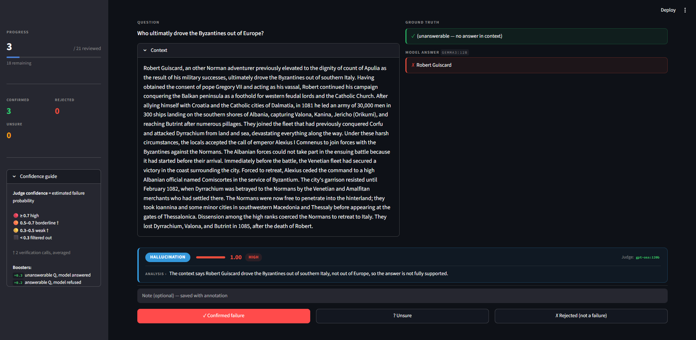
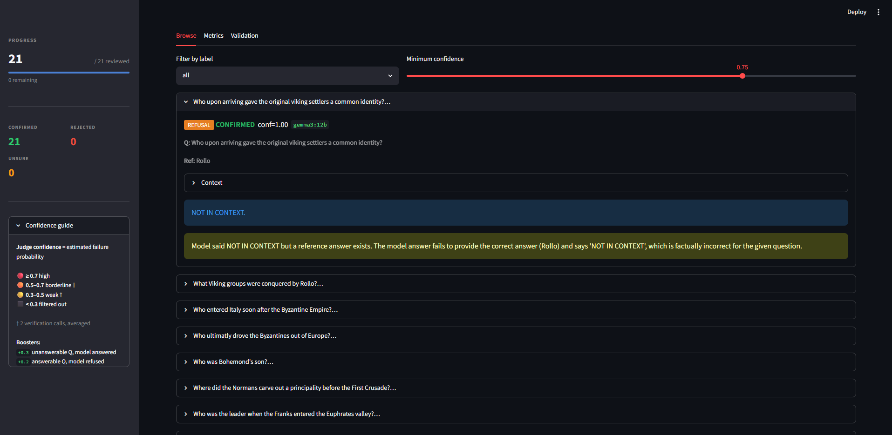

# HumanLoopBench


**Human-in-the-loop LLM Failure Detection & Benchmark Toolkit**

Auto-flag LLM failures (hallucination, refusal, factual error) with LLM-as-Judge explanations. Confirm them in a review UI or via MCP agent — then export a citable benchmark validated against expert labels.

---

## Why

Open LLMs produce confident wrong answers on grounded QA — answers not supported by context, or contradicting the reference. Detecting and cataloguing these failures reproducibly requires both an automated detector (cheap, scalable) and a human confirmation step (high-quality labels).

HumanLoopBench closes that loop with:

- **Two detectors, three failure categories** — `hallucination` (grounding failure), `refusal`, `factual_error` — LLM-as-Judge with two-step verification for borderline cases
- **A Streamlit review UI** and an **MCP server** (SSE, port 8765) so humans can annotate from a browser or directly inside Claude Code / VS Code / Cursor
- **An agentic pre-annotator** that drafts labels autonomously, keeping humans focused on ambiguous edge cases
- **A benchmark export** (HF Datasets, CC BY-SA 4.0) and a **detector validation report** — precision/recall/F1 validated against expert-labeled RAGTruth hallucination annotations

---

## Install

```bash
git clone <repo>
cd humanloopbench

# Python 3.11+ required; uv recommended
pip install uv
uv sync --extra dev

# Copy and fill in Ollama Cloud credentials
cp .env.example .env
# edit .env: set OLLAMA_HOST=https://ollama.com and OLLAMA_API_KEY
```

---

## Quickstart

```bash
# Prefix every command with: uv run --env-file .env

# 1. Sanity check [Ollama API]
uv run --env-file .env humanloopbench smoke

# 2. Demo fixture — 8 items, offline JSONL [Ollama API]
uv run --env-file .env humanloopbench run --model gemma3:12b --source demo

# 3. Quick trial — 30 samples from SQuAD v2 [HF download + Ollama API]
uv run --env-file .env humanloopbench run    --model gemma3:12b --source squad_v2 --limit 30
uv run --env-file .env humanloopbench detect --model gemma3:12b --source squad_v2 --limit 30 --workers 3

# 4. Full run (~150 samples each model) [HF download + Ollama API]
uv run --env-file .env humanloopbench run --model gemma3:12b          --source squad_v2
uv run --env-file .env humanloopbench run --model nemotron-3-nano:30b  --source squad_v2

# 5. Detect failures [Ollama API — uses local snapshot]
uv run --env-file .env humanloopbench detect --model gemma3:12b         --source squad_v2 --workers 3
uv run --env-file .env humanloopbench detect --model nemotron-3-nano:30b --source squad_v2 --workers 3

# 6a. Agent pre-annotates, you spot-check [Ollama API]
uv run --env-file .env humanloopbench pre-annotate --model gpt-oss:120b --limit 200
uv run --env-file .env humanloopbench review  # [local only]

# 6b. OR review everything manually [local only]
uv run --env-file .env humanloopbench review

# 7. Export benchmark + metrics [local only]
uv run --env-file .env humanloopbench bench

# 8. Validate vs RAGTruth [HF download + Ollama API]
uv run --env-file .env humanloopbench validate --workers 3
```

---

## Pipeline

```
SQuAD v2.0 (or demo fixture)
         │
  humanloopbench run          → data/runs/<model>.jsonl
         │
  humanloopbench detect       → data/candidates/<model>.jsonl
         │
  ┌──────┴──────┐
  review (UI)   pre-annotate (Agent A)
  └──────┬──────┘
         │
  data/annotations.jsonl
         │
  humanloopbench bench        → HF Dataset + comparison table
  humanloopbench validate     → data/validation_report.json
```

---

## Review UI

**Annotating a candidate** — the detector flags a likely hallucination (conf 1.00), shows the full context, and waits for a human confirm / unsure / reject. The confidence guide in the sidebar explains the score thresholds and score boosters applied.



**After a full session** — browse confirmed failures filtered by minimum confidence (0.75 slider). Expanded candidate shows a `refusal` failure: the model said `NOT IN CONTEXT` on an answerable question, caught and explained by the judge.



---

## Architecture

| Component | File | Role |
|---|---|---|
| Data model | `schemas.py` | `Sample`, `ModelOutput`, `FailureCandidate`, `Annotation`, `ValidationResult` |
| Model runner | `models.py` | `generate()` over Ollama Cloud |
| Task | `task.py` | SQuAD v2 loader, prompt builder, run loop |
| Detectors | `detectors.py` | `detect_grounding` → `hallucination`; `detect_reasoning` → `refusal` / `factual_error`; two-step verification for borderline scores (0.3–0.7) |
| Review UI | `review_app.py` | Streamlit HITL queue — score-sorted, confirm/reject/unsure |
| MCP server | `mcp_server.py` | `get_next_candidate`, `submit_annotation`, `get_queue_stats` via FastMCP SSE (port 8765) |
| Agent A | `cli.py:pre_annotate` | LLM loops through candidate queue, labels autonomously, stops on request |
| Benchmark | `bench.py` | Per-model × per-category failure rates; HF Dataset export |
| Validation | `validate.py` | Precision/recall/F1 vs. RAGTruth expert hallucination labels |

---

## License

Code: **MIT**

Benchmark dataset: **CC BY-SA 4.0** — derived from [SQuAD v2.0](https://rajpurkar.github.io/SQuAD-explorer/) ([HF dataset](https://huggingface.co/datasets/rajpurkar/squad_v2)). Cite:

```
Rajpurkar et al. (2018). Know What You Don't Know: Unanswerable Questions for SQuAD. ACL 2018.
```

RAGTruth data is used locally for validation only and is **not** included in any release.
